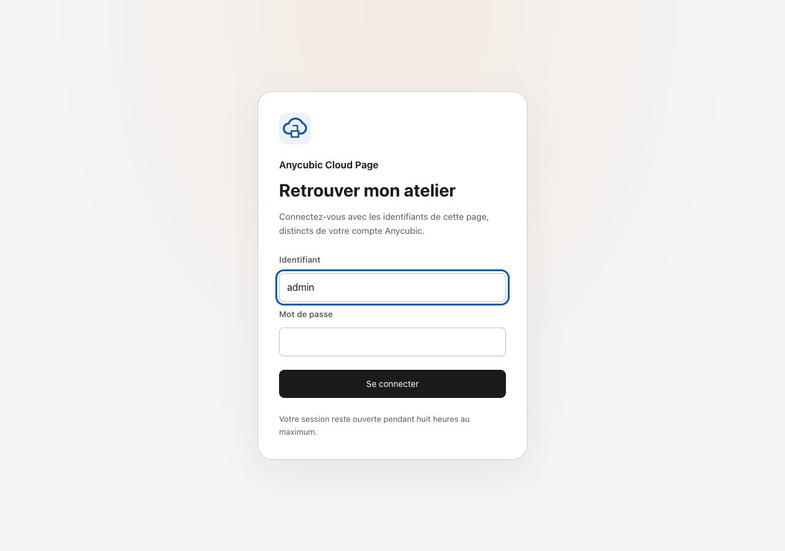

# Anycubic Cloud Page

Version **1.6.0**. [Changelog](CHANGELOG.md).

**A standalone web workshop for Anycubic Cloud, without keeping AnycubicSlicerNext open.**

[](https://github.com/mcflykid/anycubic-cloud-page/releases/latest)
[](https://github.com/mcflykid/anycubic-cloud-page/issues?q=is%3Aissue+is%3Aopen)
[](https://github.com/mcflykid/anycubic-cloud-page/issues?q=is%3Aissue+is%3Aclosed)
[](https://github.com/mcflykid/anycubic-cloud-page/milestone/3)
[](https://github.com/mcflykid/anycubic-cloud-page/commits/main)

[Français / full screenshot gallery](README.md) · [Cloud authentication and token recovery](docs/CLOUD-CONNECTION.md) · [Compatibility](docs/COMPATIBILITY.md)

A self-hosted Python/aiohttp application with a responsive French interface: printer status, ACE/filament management, local/USB/cloud files, G-code upload, Agora camera, print history and settings. Home Assistant is not required. With several printers, the top-bar selector remembers the browser’s last choice; commands carry an explicit printer target.

## Quick start

Docker Compose is sufficient. From an empty directory, download the files of the latest release:

```sh
curl -fL https://github.com/mcflykid/anycubic-cloud-page/releases/latest/download/compose.yaml -o compose.yaml
curl -fL https://github.com/mcflykid/anycubic-cloud-page/releases/latest/download/default.env.example -o .env.example
cp .env.example .env
chmod 600 .env
```

1. Set ANYCUBIC_EMAIL, ANYCUBIC_PASSWORD and WEB_PASSWORD in `.env`. WEB_USER defaults to admin; the web password requires six characters.
2. Run `docker compose config --quiet`, then `docker compose up -d`.
3. Open **http://localhost:8080/imprimante.html** and sign in with your web credentials.
4. For remote access, set the exact PUBLIC_ORIGIN and follow the [reverse proxy guide](docs/REVERSE-PROXY.md).

The image follows `latest`; pin a published image tag in compose.yaml if you need a fixed release. All persistent data stays under APPDATA_DIR (default `./appdata`). A container proxy uses the same file with PROXY_NETWORK and PROXY_NETWORK_EXTERNAL=true. The HTTP port remains bound to 127.0.0.1 by default. **Never expose it directly to the Internet.** See also the [central environment example](docs/REVERSE-PROXY.md#intégrer-à-une-stack-existante-avec-un-env-central-et-dockerdir) and the [installation guide](docs/INSTALLATION.md).

## Work tracking

[Open issues](https://github.com/mcflykid/anycubic-cloud-page/issues?q=is%3Aissue+is%3Aopen) describe proposed fixes and improvements. The [upcoming release milestone](https://github.com/mcflykid/anycubic-cloud-page/milestone/8) groups work for the next release and its acceptance criteria.

## Screens

The language selector next to the notification bell remembers French, English or Spanish in the browser. If the translation catalogue cannot load, the workshop and sign-in page use French.

| Tab | Features | Screenshot |
| --- | --- | --- |
| Printer | State, preview, progress and live temperatures | [View](screenshots/10-session.jpg) |
| ACE / filaments | Spools, RFID information, remaining filament and drying | [View](screenshots/02-ace-filaments.png) |
| Files | Printer memory, USB and cloud file operations | [View](screenshots/03-fichiers.png) |
| Upload / print | Cloud storage for G-code, STL and 3MF, plus G-code printing with ACE mapping | [View](screenshots/04-envoyer-imprimer.png) |
| Camera | Agora video, zoom, lights and guarded axis controls | [View](screenshots/05-camera.png) |
| History | Status/date/name filters, preview cards, details and confirmed cloud history removal; notifications in the top-bar bell | [View](screenshots/06-historique.png) |
| Statistics | Local charts for the past 24 hours covering temperatures, ACE humidity and estimated remaining filament by slot | — |
| Settings | Connection, AI settings and update eligibility | [View](screenshots/07-reglages.png) |

All public screenshots use synthetic demo data. The camera illustration is not a real video stream.

In **Settings → Appearance**, choose the default, Apple Design, Minimalist, Detailed, Halloween or Christmas style. Light, dark and system mode are independent. Print history includes a date-range calendar. The spool details show the detected RFID color and lock edits to the material and color.

## Offline demo

```sh
python3 -m venv .venv
. .venv/bin/activate
pip install -r app/requirements.txt
python app/demo.py
```

Open `http://127.0.0.1:8081`. The demo never connects to Anycubic and rejects physical commands.

## Scope and credits

Initially exercised with a Kobra S1 Combo and ACE 2 Pro. Read operations, cloud file test operations and the original camera path have real observations; physical actions and firmware installation are not all validated. Cloud acceptance is not physical confirmation. See the [compatibility matrix](docs/COMPATIBILITY.md).

The cloud engine derives from [ljschmitt/hass-anycubic_cloud_v3](https://github.com/ljschmitt/hass-anycubic_cloud_v3). This project does not claim to be the first implementation of Anycubic Cloud access. It provides a separate workshop UI and documents its authentication, session, preview and MQTT adaptations. See [third-party notices](THIRD_PARTY_NOTICES.md).

GPL-3.0-or-later. Independent community project; not an official Anycubic product.

`TZ` defaults to `Europe/Paris` and controls history, chart labels and application log times. `PUID`/`PGID` default to `1000`. Startup prepares `appdata` as root, then starts the server without root privileges. `init: true`, `pids_limit: 100`, resource limits, read-only root and privilege restrictions are enabled. `/etc/localtime` is mounted read-only. The unhealthy-restart label is commented out and requires an external tool.

## Web sign-in

The French `/login` form uses an eight-hour session cookie: HttpOnly, SameSite=Strict, and Secure when `PUBLIC_ORIGIN` is HTTPS. Sign-out revokes the session. Five failures per five-minute window limit attempts per connection address; users behind a proxy may share this limit. Restarting the application or changing the web password invalidates sessions.


