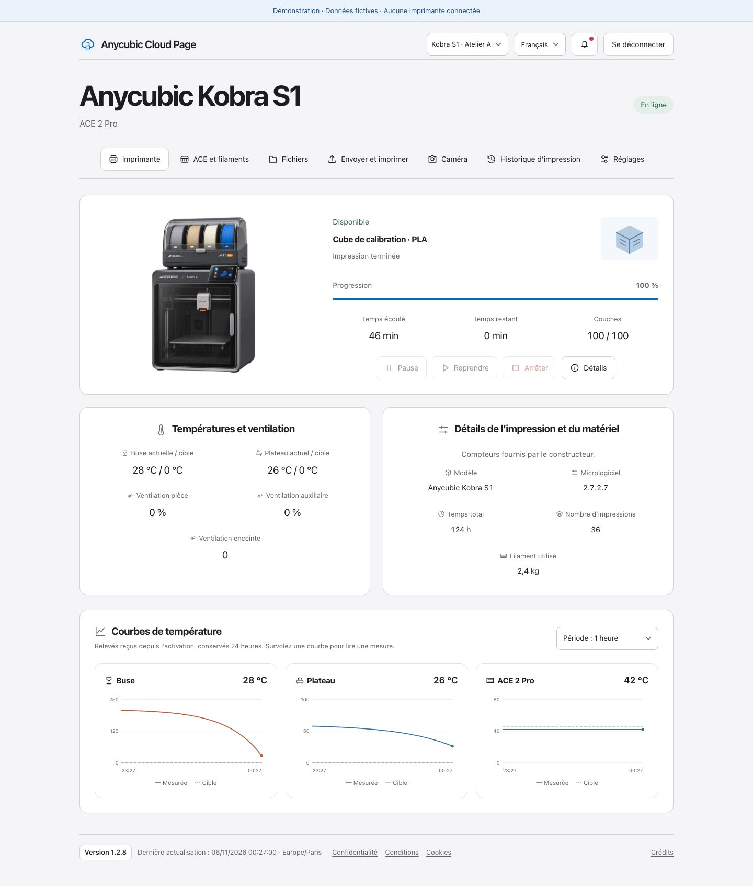
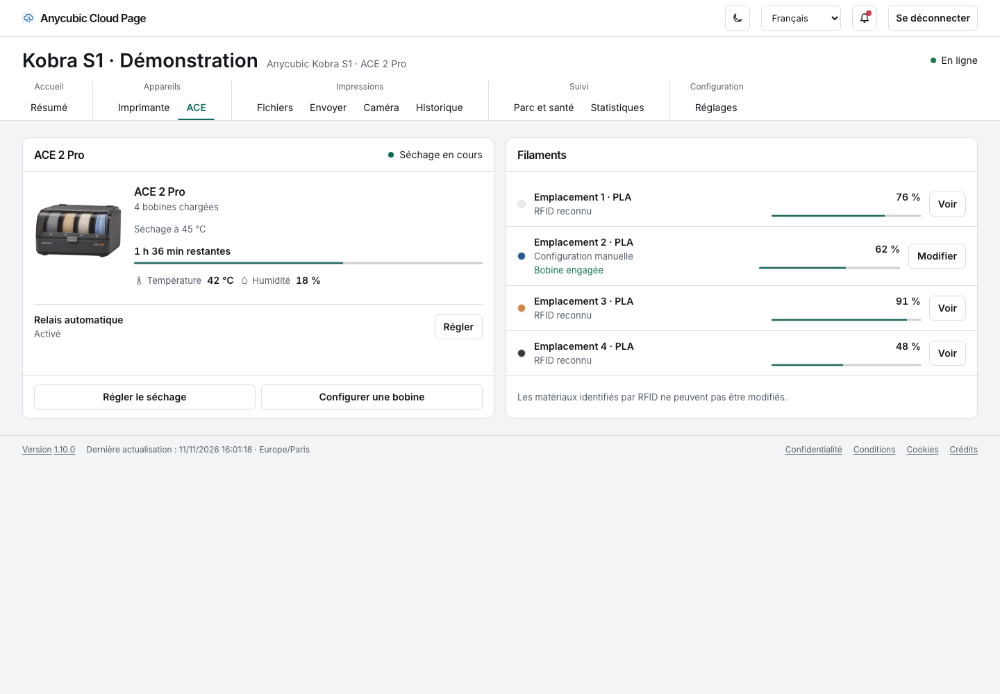
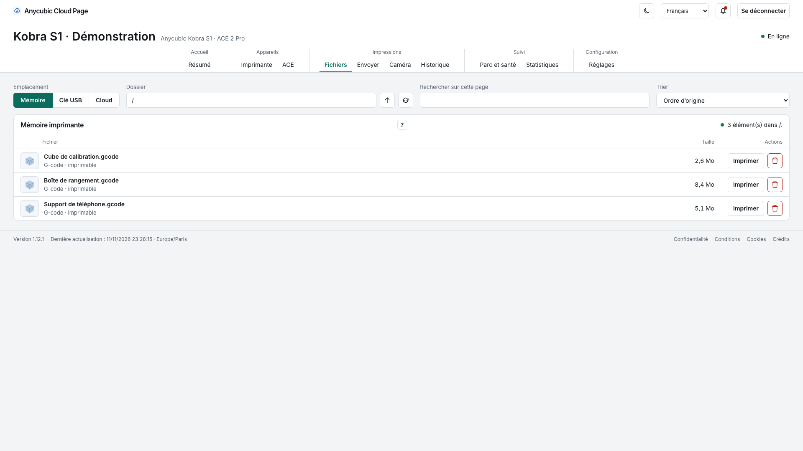
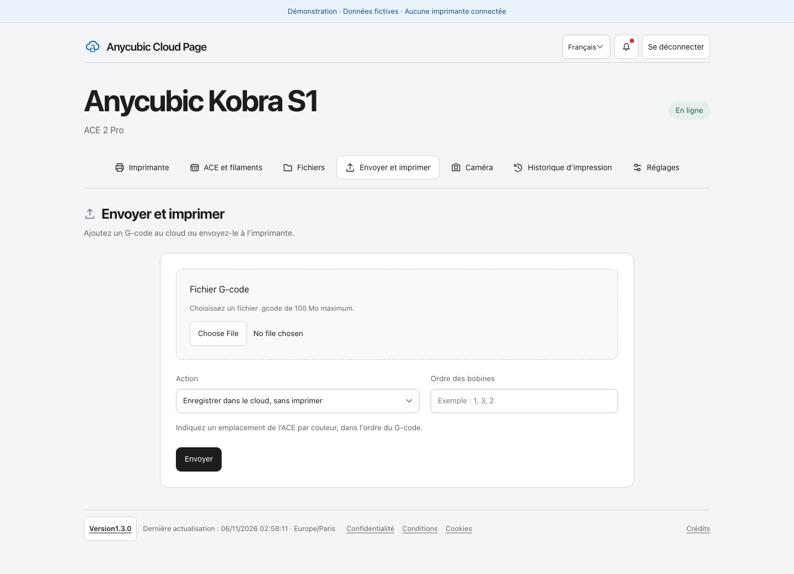
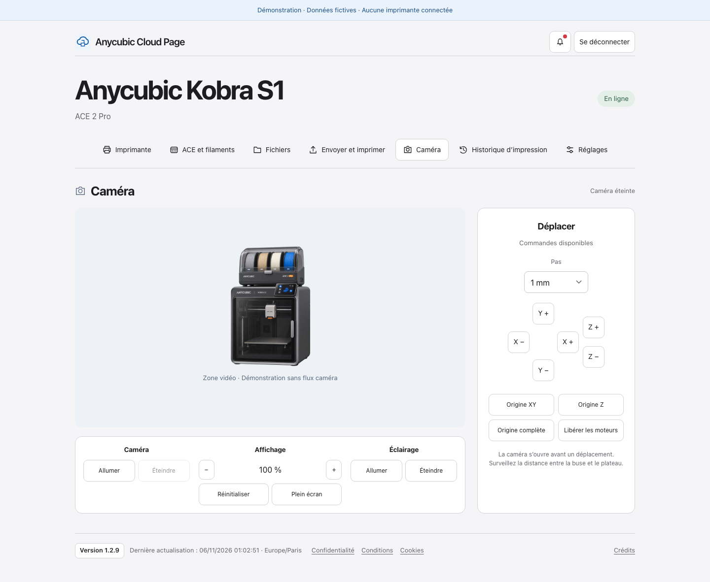
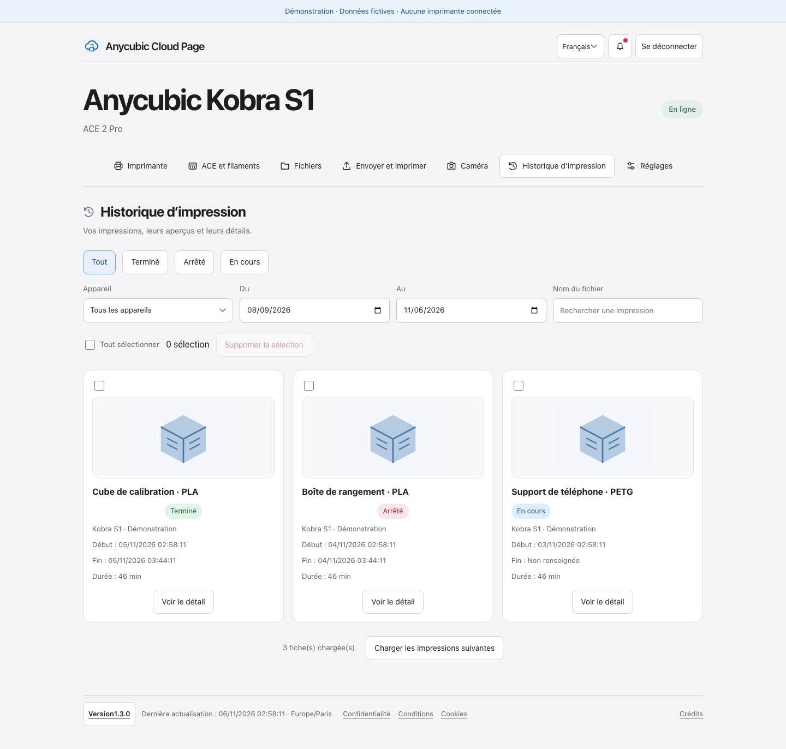
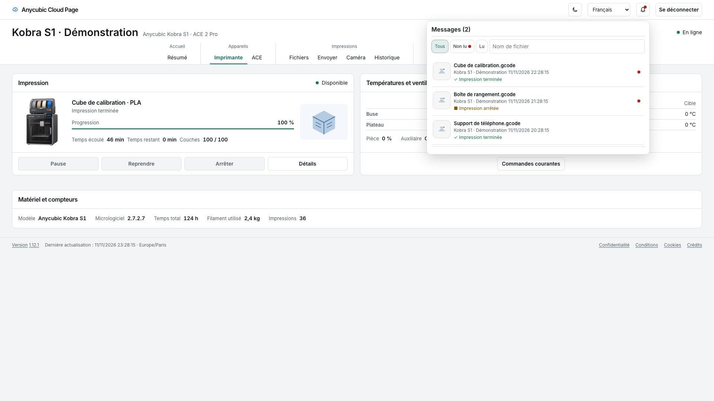
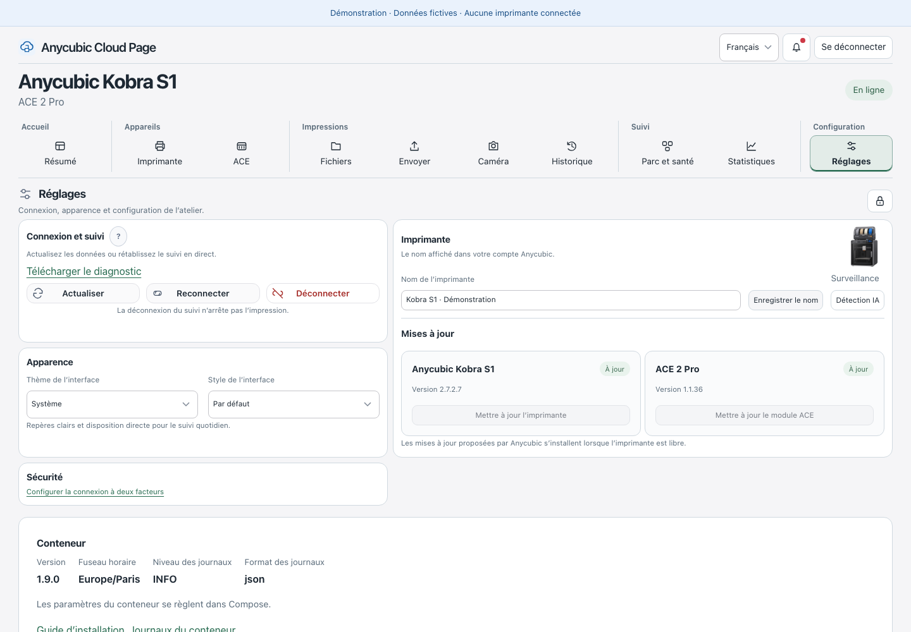
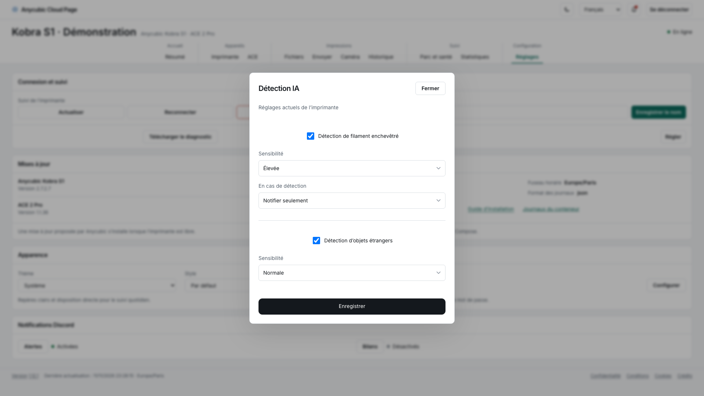

# Anycubic Cloud Page

Version **1.2.10**. [Changements](CHANGELOG.md).

**L’atelier Anycubic dans une page web autonome, sans garder AnycubicSlicerNext ouvert.**

[](https://github.com/mcflykid/anycubic-cloud-page/actions/workflows/ci.yml)
[](LICENSE)
[](Dockerfile)

[](https://github.com/mcflykid/anycubic-cloud-page/releases/latest)
[](https://github.com/mcflykid/anycubic-cloud-page/issues?q=is%3Aissue+is%3Aopen)
[](https://github.com/mcflykid/anycubic-cloud-page/issues?q=is%3Aissue+is%3Aclosed)
[](https://github.com/mcflykid/anycubic-cloud-page/milestone/2)
[](https://github.com/mcflykid/anycubic-cloud-page/commits/main)

[English](README.en.md) · [Installation](docs/INSTALLATION.md) · [Connexion cloud et tokens](docs/CLOUD-CONNECTION.md) · [Protocole et découvertes](docs/PROTOCOL.md) · [Compatibilité](docs/COMPATIBILITY.md)

Ce projet transforme les fonctions d’atelier du cloud Anycubic en une interface web indépendante : suivi d’impression, ACE et bobines, fichiers, envoi de G-code, caméra, historique et réglages. Le serveur Python dialogue avec Anycubic par HTTP et MQTT ; le navigateur n’a pas besoin de lancer le slicer. Aucun Home Assistant requis. Avec plusieurs imprimantes, un sélecteur dans la barre du haut retrouve le dernier choix du navigateur ; les commandes portent une cible explicite.

**Deux méthodes d’accès :** connexion directe au compte Anycubic, avec récupération automatique du token **sans slicer**, ou récupération locale d’un token dans les journaux d’AnycubicSlicerNext. Les limites et la procédure reproductible sont détaillées dans le [guide de connexion](docs/CLOUD-CONNECTION.md).

Projet communautaire indépendant, issu d’essais sur une **Kobra S1 Combo + ACE 2 Pro**. Il utilise des services privés du constructeur : il ne constitue pas une API officielle ni une promesse de compatibilité avec tous les modèles. Les travaux de [ljschmitt/hass-anycubic_cloud_v3](https://github.com/ljschmitt/hass-anycubic_cloud_v3) fournissent le moteur cloud initial ; nos adaptations et observations sont [créditées et documentées](THIRD_PARTY_NOTICES.md).



## Démarrage rapide

Docker Compose suffit. Depuis un dossier vide, téléchargez les fichiers de la dernière release :

```sh
curl -fL https://github.com/mcflykid/anycubic-cloud-page/releases/latest/download/compose.yaml -o compose.yaml
curl -fL https://github.com/mcflykid/anycubic-cloud-page/releases/latest/download/default.env.example -o .env.example
cp .env.example .env
chmod 600 .env
```

1. Renseignez ANYCUBIC_EMAIL, ANYCUBIC_PASSWORD et WEB_PASSWORD dans `.env`. WEB_USER vaut admin par défaut ; le mot de passe web contient au moins six caractères.
2. Lancez `docker compose config --quiet`, puis `docker compose up -d`.
3. Ouvrez **http://localhost:8080/imprimante.html** et connectez-vous avec vos identifiants web.
4. Pour un accès distant, réglez PUBLIC_ORIGIN sur l’origine exacte et suivez le [guide reverse proxy](docs/REVERSE-PROXY.md).

L’image suit `latest` ; remplacez-la par un tag publié dans compose.yaml pour figer une livraison. Les données restent dans APPDATA_DIR (`./appdata` par défaut). Un proxy en conteneur utilise le même fichier avec PROXY_NETWORK et PROXY_NETWORK_EXTERNAL=true. Le port HTTP reste local par défaut sur 127.0.0.1. **Ne l’exposez jamais directement sur Internet.** Voir aussi l’[exemple d’environnement central](docs/REVERSE-PROXY.md#intégrer-à-une-stack-existante-avec-un-env-central-et-dockerdir) et le [guide d’installation](docs/INSTALLATION.md).

## Suivi des travaux

Les [issues ouvertes](https://github.com/mcflykid/anycubic-cloud-page/issues?q=is%3Aissue+is%3Aopen) décrivent les corrections et améliorations proposées. La [milestone 1.3.0](https://github.com/mcflykid/anycubic-cloud-page/milestone/2) regroupe les travaux de la prochaine version et leurs critères de validation.

## Les sept onglets

Les captures ci-dessous proviennent du **mode démonstration**, avec des données fictives. Elles ne montrent aucun compte réel, aucun identifiant d’imprimante, ni aucun flux vidéo privé. Les captures originales sont dans [`screenshots/`](screenshots/README.md).

| Onglet | Ce qu’il permet |
| --- | --- |
| **Imprimante** | Consulter l’état, le projet, sa miniature, la progression, les couches, les températures et les courbes locales sur 24 h. Pause/reprise/arrêt soumis à l’état de la machine. |
| **ACE et filaments** | Voir les quatre emplacements, les informations RFID disponibles, les quantités rapportées, la bobine engagée et le séchage ; ouvrir les fenêtres de configuration. |
| **Fichiers** | Parcourir la mémoire de l’imprimante, l’USB ou le cloud ; prévisualiser, préparer une impression et gérer les fichiers selon les fonctions fournies. |
| **Envoyer et imprimer** | Envoyer un G-code au cloud, le conserver sans imprimer ou préparer son impression avec l’ordre des bobines ACE. |
| **Caméra** | Ouvrir le flux Agora, zoomer, passer en plein écran, piloter l’éclairage et accéder aux déplacements autorisés. |
| **Historique** | Filtrer les impressions par statut, dates et nom ; consulter cartes et détails ; retirer les fiches sélectionnées de l’historique cloud après confirmation. Les notifications sont dans la cloche. |
| **Réglages** | Gérer le nom et le suivi de connexion, consulter la détection IA et les versions ; proposer les mises à jour seulement si Anycubic les annonce. |

<details>
<summary><strong>ACE et filaments</strong> — bobines, RFID et séchage</summary>



</details>

<details>
<summary><strong>Fichiers</strong> — mémoire, USB et cloud</summary>



</details>

<details>
<summary><strong>Envoyer et imprimer</strong> — G-code et ordre des bobines</summary>



</details>

<details>
<summary><strong>Caméra</strong> — vidéo, éclairage et déplacements</summary>

L’image de cette capture est une illustration de démonstration, pas une caméra simulée ni un flux réel. La connexion vidéo réelle passe par Agora.



</details>

<details>
<summary><strong>Historique</strong> — tâches et miniatures</summary>





</details>

<details>
<summary><strong>Réglages</strong> — versions, connexion et détection IA</summary>





</details>

## Ce qui a été découvert et adapté

- Connexion au User Center par **code d’autorisation + PKCE S256**, permettant de récupérer un token directement depuis le compte sans lancer le slicer.
- Échange du token d’accès contre une session de l’API workbench, puis reprise sur rejet explicite de session, avec verrou et temporisation. Une requête dont le résultat est ambigu n’est pas renvoyée automatiquement.
- Miniatures de fichiers locaux obtenues par la consultation native `1239`, et extraction de `file_details.thumbnail` ; aperçu d’une tâche associé à sa référence, pas à un nom approximatif.
- Réponses de détection IA reçues en MQTT avec un `msgid` **différent de l’acquittement HTTP**. La consultation est bornée dans le temps, contrôlée par imprimante, type et action.
- Téléchargements cloud résolus fichier par fichier pour conserver la bonne association nom/contenu ; normalisation des extensions lors du renommage.
- Séparation entre une **version cible renseignée** et une **mise à jour réellement proposée** par le constructeur.

La [note de protocole](docs/PROTOCOL.md) explique comment reproduire ces mécanismes et distingue les observations en situation réelle des tests simulés. Nous ne revendiquons pas avoir inventé l’accès au cloud Anycubic : le projet assemble une interface autonome et documente ses adaptations à partir de briques existantes.

## Essayer sans compte ni imprimante

```sh
python3 -m venv .venv
. .venv/bin/activate
pip install -r app/requirements.txt
python app/demo.py
```

Ouvrez [http://127.0.0.1:8081](http://127.0.0.1:8081). La démonstration fonctionne sans token ni connexion à Anycubic ; elle refuse les commandes réelles. Elle sert aussi à reproduire les captures du README.

## État de validation

Le déploiement d’origine a permis de vérifier la connexion directe au compte, les sessions cloud/MQTT, la caméra Kobra S1, les miniatures locales, l’historique et la lecture IA. Les opérations cloud de téléchargement/renommage/suppression ont été vérifiées sur des fichiers d’essai dédiés.

La présence d’un bouton ne garantit pas sa validation physique : mouvements, chauffe, chargement, séchage, lancement d’impression, écriture IA et installation de firmware nécessitent des essais contrôlés sur chaque matériel. Le renouvellement OAuth est couvert par des tests simulés ; son succès réel à long terme n’est pas établi. Les aperçus de notifications ont été testés avec des données simulées, le journal réel étant vide au contrôle. Voir la [matrice complète](docs/COMPATIBILITY.md).

## Développement

```sh
pip install -r app/requirements.txt
python -m unittest discover -s app -p 'test_*.py' -q
python -m unittest discover -s scripts -p 'test_*.py' -q
node --check web/js/imprimante.js
python scripts/update_assets.py
python scripts/check_publication.py
```

[Contribuer](CONTRIBUTING.md) · [Signaler un problème](https://github.com/mcflykid/anycubic-cloud-page/issues) · [Sécurité](SECURITY.md) · [Changelog](CHANGELOG.md)

## Licence et origine

Code sous **GPL-3.0-or-later**, avec conservation du moteur amont et de sa licence. Le lecteur caméra Agora est une dépendance externe épinglée et téléchargée au build ; ses conditions restent celles de son éditeur. Les illustrations locales de l’imprimante et de l’ACE sont des visuels non officiels, créés pour l’interface. Les marques Anycubic et Agora appartiennent à leurs titulaires respectifs. Voir [les notices tierces](THIRD_PARTY_NOTICES.md).

## Connexion à l’atelier

La page `/login` remplace la fenêtre du navigateur. La session est limitée à huit heures, avec cookie HttpOnly, SameSite=Strict et Secure lorsque `PUBLIC_ORIGIN` utilise HTTPS. Le bouton « Se déconnecter » révoque la session. Cinq échecs dans une fenêtre de cinq minutes limitent les tentatives par adresse de connexion ; derrière un proxy, configurez `TRUSTED_PROXIES` selon le [guide reverse proxy](docs/REVERSE-PROXY.md#compteurs-de-connexion-et-proxys-de-confiance) pour séparer les compteurs des utilisateurs. Les sessions sont aussi invalidées au redémarrage ou après changement du mot de passe web.


