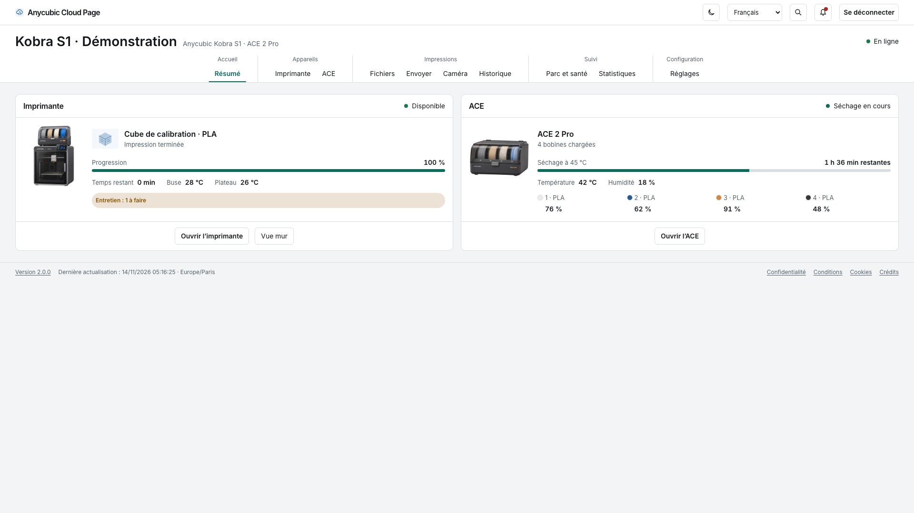

# Anycubic Cloud Page

**Suivez et pilotez votre imprimante Anycubic depuis un navigateur.** L’atelier est auto-hébergé et se connecte à votre compte Anycubic Cloud. Le trancheur reste l’outil de préparation des pièces. L’atelier prend le relais pour consulter les fichiers, suivre l’impression et gérer l’ACE.

[English](README.en.md) · [Version 2.1.0 et changements](CHANGELOG.md) · [Releases](https://github.com/mcflykid/anycubic-cloud-page/releases) · [Captures](screenshots/README.md)



## Installer avec Docker Compose

Préparez un compte Anycubic avec une imprimante associée et un hôte Docker Linux **amd64 ou arm64**. Dans un dossier vide, téléchargez le fichier Compose et le modèle de configuration de la release.

```sh
curl -fL https://github.com/mcflykid/anycubic-cloud-page/releases/latest/download/compose.yaml -o compose.yaml
curl -fL https://github.com/mcflykid/anycubic-cloud-page/releases/latest/download/default.env.example -o .env.example
cp .env.example .env
chmod 600 .env
```

1. Renseignez `ANYCUBIC_EMAIL` et `ANYCUBIC_PASSWORD` dans `.env`, puis choisissez un `WEB_PASSWORD` distinct. L’identifiant web par défaut est `admin`.
2. Lancez `docker compose up -d`.
3. Ouvrez [l’atelier sur la machine qui héberge Docker](http://localhost:8080/imprimante.html). Le service écoute localement par défaut.

Les données persistent dans `./appdata`. Pour figer une version, renseignez `APP_IMAGE` avec son tag dans `.env`. Pour accéder à l’atelier depuis un autre appareil, configurez votre proxy HTTPS et l’origine publique correspondante. [Installation et mises à jour](docs/INSTALLATION.md) · [Proxy HTTPS](docs/REVERSE-PROXY.md) · [Connexion Anycubic](docs/CLOUD-CONNECTION.md)

## Ce que vous pouvez faire

| Dans l’atelier | Fonctions |
| --- | --- |
| Résumé, Imprimante et Vue mur | Progression, couches, fin prévue, températures, ventilation, chronologie et actions selon l’état de la machine. |
| ACE et filaments | Identification RFID, quantités rapportées, catalogue Anycubic, fiches personnelles et conseil de séchage. |
| Fichiers, Envoyer et imprimer | Mémoire de l’imprimante, USB et Cloud. Opérations selon la source et le format. Lancement des fichiers tranchés pris en charge. |
| Caméra et Historique | Vidéo en direct, aperçu et détails d’impression, recherche et filtres. |
| Parc et santé, Statistiques et Réglages | État des imprimantes, relevés, connexion à deux facteurs, notifications Discord et notes de micrologiciel disponibles. |

Les essais de référence portent sur une **Kobra S1 avec ACE 2 Pro**. La disponibilité des commandes dépend du modèle, du micrologiciel et des capacités rapportées. Le timelapse a été demandé lors d’un essai court, sans clip observé. Les modes de séchage combinés au lancement restent indisponibles. [Matrice de compatibilité](docs/COMPATIBILITY.md) · [Fiches filament](docs/FICHES-FILAMENT.md) · [Notifications](docs/NOTIFICATIONS.md)

## Essayer avec des données fictives

Depuis le dépôt, avec Python 3.13 :

```sh
python3 -m venv .venv
. .venv/bin/activate
pip install -r app/requirements.txt
python app/demo.py
```

Ouvrez [la démonstration locale](http://127.0.0.1:8081). Elle fonctionne sans compte Anycubic et sans imprimante.

Projet communautaire indépendant sous [GPL-3.0-or-later](LICENSE), avec un moteur Cloud issu de [hass-anycubic_cloud_v3](https://github.com/ljschmitt/hass-anycubic_cloud_v3). [Notices tierces](THIRD_PARTY_NOTICES.md) · [Contribution](CONTRIBUTING.md) · [Dépannage](docs/TROUBLESHOOTING.md) · [Sécurité](SECURITY.md)
