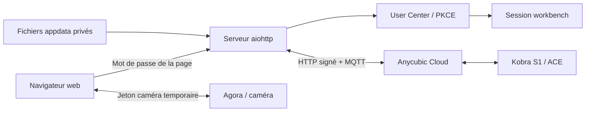

# Notes de protocole et adaptations

Cette note accompagne le code et la [connexion cloud](CLOUD-CONNECTION.md). Les observations ont été réalisées sur une Kobra S1 Combo et un ACE 2 Pro ; les autres modèles restent à tester.

L’[inventaire des capacités cloud](CLOUD-CAPABILITIES.md) distingue les fonctions utilisées, les possibilités non implémentées et les paramètres encore inconnus, avec leurs sources et leurs risques.

## Architecture

`app/anycubic_cloud_api/` dérive du client GPL existant ; `server.py`, `cloud_extras.py`, `account_auth.py`, `session_api.py`, les helpers et le frontend forment l’adaptation autonome. Le moteur reste côté serveur. La page web ne possède pas de token de compte et n’accède pas directement aux identifiants de l’imprimante.

## Plusieurs imprimantes

Le [registre de machines](../app/printer_registry.py) conserve un moteur, ses caches et ses verrous par cible. La sélection appartient au navigateur, pas à une variable globale partagée entre utilisateurs. Chaque requête de commande porte l’en-tête `X-Printer-Key`, référence opaque obtenue avec `/imprimante-api/printers`. La cible est contrôlée à nouveau sous verrou avant l’envoi ; une référence périmée ou absente ne déclenche aucun repli vers une autre machine. Les liens de téléchargement utilisent cette même référence dans leur paramètre `printer`.

Le protocole Slicer construit un identifiant MQTT fixe pour un compte. Les moteurs partagent donc une seule connexion et routent les rapports selon leur machine ; ils ne créent pas des clients concurrents de même nom. Le renouvellement de session conserve ce transport commun, les abonnements sont rétablis et les callbacks de fraîcheur restent associés au destinataire du rapport. Les courbes initiales gardent leur emplacement ; les machines supplémentaires utilisent des sous-dossiers privés sous `appdata/state/printers/`.

## Parcours utiles

| Besoin | Mécanisme |
| --- | --- |
| État | Polling cloud toutes les 60s et messages MQTT ; lecture du cache par le navigateur toutes les 3s. |
| Miniature d’un fichier local/USB | Ordre `1239`, référence au chemin et au plateau ; réponse MQTT corrélée, puis extraction de `file_details.thumbnail` ou `png_image`. |
| Historique natif | `GET /v2/project/printHistory`, distinct des messages de notification. |
| Détail d’une tâche | `/v5/project/printHistory/detail`, avec repli sur le détail projet lorsque disponible. |
| Aperçus d’historique | Référence de tâche/projet et image native ; aucun rapprochement approximatif par nom de fichier. |
| Notifications | `/v2/message/getMessages`, compteurs, lecture et suppression dédiés ; aperçu propre à la notification ou référence explicite de projet. |
| Téléchargement cloud | `/work/index/getDownloadUrls`, appelé par identifiant pour éviter une association incorrecte lorsque la réponse est réordonnée. |
| Détection IA | Ordre de lecture `1242`, écriture `1243` ; voir la différence de `msgid` dans le guide de connexion. |
| Firmware | Indicateur `update_available` du constructeur ; une simple version cible ne signifie pas qu’une mise à jour est disponible. |

Ces chemins désignent l’API du fournisseur, pas l’API locale du projet. L’API locale est sous `/imprimante-api/`.

## Fiabilité des actions

Le serveur valide les valeurs, la disponibilité de l’imprimante et les références connues avant les opérations. Les demandes portent un identifiant pour limiter les doubles soumissions. Les actions dangereuses de l’interface demandent une confirmation ; la réinitialisation, lorsqu’elle est annoncée par un modèle, possède une étape supplémentaire à code temporaire.

Les réponses « commande acceptée » signifient que le transport a accepté la demande. Elles ne prouvent ni le déplacement d’un axe, ni une température atteinte, ni une impression ou une mise à jour terminée. Aucun timeout ambigu ne déclenche une seconde commande automatique.

## Images et téléchargements

Les miniatures distantes sont récupérées côté serveur. Schéma HTTPS, domaines autorisés, type MIME, taille maximale et absence de redirection sont contrôlés. Les URLs signées d’images ne sont pas renvoyées au navigateur ; l’interface reçoit une image encodée. Les liens de téléchargement cloud sont temporaires et limités aux domaines fournisseur autorisés.

Le cache des aperçus est borné. Un aperçu indisponible est signalé ; une image d’un autre projet ne lui est pas substituée. Un code de diagnostic zéro ne devient pas un texte d’erreur ; les messages non vides et codes non nuls sont conservés.

## TLS MQTT

Le client d’origine utilise des certificats historiques signés en SHA-1. Le contexte fourni réduit localement le niveau de sécurité OpenSSL pour accepter ces certificats tout en conservant TLS1.2 minimum, la CA constructeur, la vérification de validité et la vérification du nom d’hôte. Cette compatibilité est limitée au client MQTT ; elle ne désactive pas les vérifications HTTPS globales.

## Ce qui reste inconnu

Les services étant privés et évolutifs, les noms de champs, capacités de firmware, conditions de connexion, disponibilité des vidéos et politiques de session peuvent changer. Les réglages avancés non confirmés sont masqués. Le timelapse annoncé par la machine n’a pas fourni de liste de vidéos exploitable via le cloud au contrôle. Les notifications réelles étaient absentes lors du test d’aperçu.

## Diagnostics MQTT sans contenu privé

Le statut expose `mqtt_diagnostics`, compteurs de la connexion commune au compte : rapports inconnus, types distincts, champs supplémentaires, décodages impossibles et erreurs de traitement. Aucun nom de type, topic, identifiant, payload ni texte brut d’exception n’est renvoyé ou journalisé par ce diagnostic. Les empreintes internes de types sont limitées à 256 ; `unknown_types_capped` indique que le nombre distinct affiché est alors une borne inférieure. Les compteurs repartent de zéro si le client cloud est recréé.

Un type inconnu ne rafraîchit pas artificiellement l’état de l’imprimante. Les champs connus d’un rapport reconnu restent exploitables même si des champs supplémentaires sont ignorés. Les fixtures couvrent notamment un rapport ACE arrivé avant la liste initiale et l’indépendance des boîtiers. Aucun ordre chronologique universel n’est déduit d’un identifiant de message ou d’un horodatage dont le contrat n’est pas établi.

## Rapports récents et client amont 0.4.5 (#63)
Les rapports synthétiques couvrent les champs ACE omis (`temp`, `feed_status`), les phases de préparation et de changement de filament, `fan/query`, `extrudeControl/getInfo`, `properties/report`, `extfilbox/auto|getInfo` et `video/startCapture/pushFailed`. Les préparations marquent la machine occupée sans réactiver un projet terminé après un rapport tardif. Les réglages globaux de trajet du filament ne créent aucune bobine.

La Kobra X est reconnue par le type constructeur 20030 ou son nom exact. Ses phases 19/26/27/29/30 et son décompte de séchage restent spécifiques à ce modèle ; la conversion secondes/minutes suit les conditions du client amont 0.4.5, pas une hypothèse appliquée aux S1. Cette couverture est simulée : aucun matériel supplémentaire ni commande physique n’a été validé.

## Fraîcheur avant pause, reprise ou arrêt (#19)
L’interface transmet la référence opaque du projet affiché au moment de demander confirmation. Sous les verrous d’opération et de lecture, le serveur exige la même référence, relit le modèle par HTTP avec une limite de dix secondes et contrôle de nouveau identité, état actif et pause avant l’envoi. La méthode constructeur reçoit explicitement le projet vérifié. Une lecture échouée, une tâche remplacée ou une transition de pause annule l’envoi ; une activité MQTT sans rapport ne constitue pas une preuve de fraîcheur. Aucun ordre n’est répété automatiquement après un résultat incertain.
